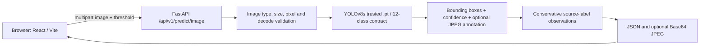

# PPE-Guard — AI-Assisted Personal Protective Equipment Detection

**Day 21 · 100 Days of Projects · Research-to-application portfolio · October 2026**

> **Research prototype / human-review tool.** PPE-Guard detects image regions bearing PPE-related source labels. It does **not** certify legal or occupational-safety compliance, identify responsible workers, or replace an authorized safety officer.

**Repository:** https://github.com/MENSTRUE/PPE-Guard  
**Stack:** YOLOv8s / Ultralytics · PyTorch `.pt` · exported ONNX · FastAPI · Python · React 18 · TypeScript · Vite 6  
**License for repository software:** MIT — see [`LICENSE`](LICENSE); third-party datasets, pretrained components, and model weights require independent rights checks.

## Contents

1. [Why this exists](#1-why-this-exists)
2. [Before → Now → Next](#2-before--now--next)
3. [Source-of-truth register](#3-source-of-truth-register)
4. [Verified research snapshot](#4-verified-research-snapshot)
5. [Dataset and annotation audit](#5-dataset-and-annotation-audit)
6. [Class contract and claim boundaries](#6-class-contract-and-claim-boundaries)
7. [Architecture and request flow](#7-architecture-and-request-flow)
8. [Repository structure](#8-repository-structure)
9. [Quick start](#9-quick-start)
10. [API and response contract](#10-api-and-response-contract)
11. [Testing and reproducibility](#11-testing-and-reproducibility)
12. [Evaluation and research limitations](#12-evaluation-and-research-limitations)
13. [Security and privacy](#13-security-and-privacy)
14. [Deployment](#14-deployment)
15. [Roadmap](#15-roadmap)
16. [Troubleshooting](#16-troubleshooting)
17. [FAQ](#17-faq)
18. [Licensing and attribution](#18-licensing-and-attribution)
19. [Contributing and document maintenance](#19-contributing-and-document-maintenance)

## 1. Why this exists

Personnel in construction and industrial environments may use hard hats, protective boots, gloves, goggles, and high-visibility vests. Manually reviewing images for these items is time-consuming, and object detectors offer a way to surface visual observations for human inspection. The distinction matters: a detector learns boxes and labels from the dataset; it does **not** know the worksite's PPE policy, who owns an item, which equipment is mandatory, whether an item meets certification standards, or why it may be absent.

PPE-Guard explores a reproducible, auditable pipeline from **dataset inventory → supervised detection experiment → held-out evaluation → trusted checkpoint → inference API → inspection UI**. The primary output is *evidence for human review*, not automated disciplinary action.

### Intended / not intended

| Intended | Not intended |
|---|---|
| Preview PPE-related bounding boxes and model scores | Decide whether an employee violated a rule |
| Record source-labeled `no_*` observations for review | Assert missing PPE based on a class not detected |
| Demonstrate research-to-product engineering | Replace OSHA/Indonesian K3 procedures or a competent inspector |
| Benchmark a mixed-ontology training experiment | Claim per-person compliance or production-grade accuracy |

## 2. Before → Now → Next

| Stage | What has been established | Evidence / remaining gate |
|---|---|---|
| **Before: dataset study** | Two dataset sources; staged selection of 8,451 images; class mapping and audit JSON | `reports/{source_inventory,annotation_inventory,selection_audit,final_summary}.json` |
| **Before: model study** | YOLOv8s experiment; 12-class contract; held-out test on 847 images | `reports/heldout_metrics.json`; checkpoint `.pt` and exported `.onnx` |
| **Now: API** | FastAPI implements health, model metadata, upload-and-detect, annotated Base64 image and conservative safety observations | `backend/`; tests with mocked inference; real-checkpoint image request tested manually in development |
| **Now: UI** | React/Vite inspection console has been added to the repository | `frontend/`; production build, browser test, and end-to-end regression must be checked for each release |
| **Next: research** | Better split-integrity audit, per-class errors, external-site evaluation and model calibration | Not completed / not claimed |
| **Next: product** | Robust visual overlay, persistent opt-in report history, auth, deployment hardening, accessibility | Planned; not claimed as implemented |

**Status vocabulary:** *implemented in code* ≠ *tested locally* ≠ *validated scientifically* ≠ *production ready*. The repository's actual files and test logs take precedence over project slogans.

## 3. Source-of-truth register

| Question | Authoritative location | Authority / caveat |
|---|---|---|
| Exact 12 class IDs | `backend/app/inference/contract.py` AND loaded model `model.names` | Runtime asserts exact match before prediction |
| Model task and architecture | `reports/final_summary.json`, checkpoint metadata | Training config details beyond recorded summary require original notebook/run |
| Dataset counts/splits | `reports/final_summary.json`; `reports/selection_audit.json` | Staged counts, **not** a claim of statistically independent samples |
| Source annotations / orphan labels | `reports/annotation_inventory.json` | Reports 10 orphan labels; inspect manifest for any remediation |
| Test metrics | `reports/heldout_metrics.json` | Aggregate detection metrics on one staged test split |
| Image-level audit provenance | `reports/staged_manifest.csv` | Large research manifest; do not publish private image paths without review |
| API behavior | Python code in `backend/app/` | Response shape and validation enforced at runtime |
| UI behavior | TypeScript in `frontend/src/` | Read source, do not assume features from a mockup |
| Software license | `LICENSE` | MIT code license only; no automatic third-party rights grant |

**No invented facts rule:** Unknown epochs, hyperparameters, hardware runtime, seed, per-class AP, ONNX parity, duplicate rate, and third-party license grants must remain **unverified** until the corresponding run metadata or source license is recorded.

## 4. Verified research snapshot

### Corpus and model

| Item | Value | File |
|---|---:|---|
| Input dataset location at training | `/kaggle/input/datasets/loliwibu/ppe-guard-datset` | `reports/final_summary.json` |
| Dataset sources | 2 | `reports/annotation_inventory.json` |
| Staged image total | **8,451** | `reports/final_summary.json` |
| Training images | **6,048** | `reports/selection_audit.json` |
| Validation images | **1,556** | same |
| Test images | **847** | same |
| Classes | **12** | `reports/final_summary.json` and checkpoint |
| Model base | `yolov8s.pt` | `reports/final_summary.json` |
| Inference PyTorch file | `models/ppe_guard_best.pt` | repository |
| ONNX export | `models/ppe_guard_best.onnx` | repository; runtime parity not established |

### Held-out test (as recorded)

| Metric | Value | Interpretation |
|---|---:|---|
| Precision | **0.6306006972** (63.06%) | Aggregate evaluation output; not a per-person compliance rate |
| Recall | **0.5392812479** (53.93%) | Nontrivial missed-detection risk |
| mAP@50 | **0.5549255102** (55.49%) | Detection AP across classes with IoU threshold 0.50 |
| mAP@50:95 | **0.2918688719** (29.19%) | Stricter averaged IoU benchmark |
| Evaluated images | **847** | Staged test split only |

These are the **recorded experiment's metrics**, not measurements taken by the frontend, a new replication, or an external-site benchmark. Do not describe 55.49% mAP as “55.49% safety compliance accuracy.”

## 5. Dataset and annotation audit

### Origins

- `Hard Hat Workers.v14-raw_headclassonly.yolov8`: its listed `data.yaml` contains **`head`** as a single class.
- `construction-ppe`: its listed `data.yaml` contains **11 classes**, with a case variant `Person` mapped to target label `person`.
- Training workspace: `/kaggle/input/datasets/loliwibu/ppe-guard-datset` (note the source path's literal spelling `datset`).

The merged target ontology consists of 12 classes. Matching label names does not prove the datasets share annotation policy. Some classes may be unlabeled in one source even when objects are visible, creating **partial-label / mixed-ontology** noise.

### Selection audit

The source inventory reports 16,917 files, including 8,298 `.jpg`, 153 `.jpeg`, 8,463 `.txt`, and two `.yaml` entries. The annotation inventory reports **10 orphan labels**. `selection_audit.json` reports `all_images=eligible=selected=8451` with no listed exclusions. **These reports measure different artifacts and should not be silently reconciled:** investigate the orphan files using `reports/staged_manifest.csv` before claiming every annotation was perfectly paired.

### Box-label distribution

| Label | Boxes | Label | Boxes |
|---|---:|---|---:|
| `head` | 26,424 | `helmet` | 1,734 |
| `person` | 2,245 | `vest` | 1,618 |
| `boots` | 1,597 | `gloves` | 1,445 |
| `none` | 797 | `no_gloves` | 556 |
| `goggles` | 518 | `no_helmet` | 485 |
| `no_goggle` | 411 | `no_boots` | 115 |

These are **bounding-box counts**, not counts of unique images, workers, or real-world incidents. The severe imbalance (especially `head` vs `no_boots`) affects per-class reliability. Before scientific publication, add exact/near-duplicate analysis across splits, image provenance and license verification, source-wise evaluation, robust negative-image policy, and run reproducibility artifacts.

More: [`reports/README.md`](reports/README.md).

## 6. Class contract and claim boundaries

| ID | Exact name | Allowed statement |
|---:|---|---|
| 0 | `helmet` | Model predicted a helmet-labeled region |
| 1 | `no_helmet` | Model predicted a source-defined `no_helmet` region; human review |
| 2 | `vest` | Model predicted a vest-labeled region |
| 3 | `boots` | Model predicted boots-labeled region |
| 4 | `gloves` | Model predicted gloves-labeled region |
| 5 | `goggles` | Model predicted goggles-labeled region |
| 6 | `head` | Model predicted a head-labeled region; **NOT proof of no helmet** |
| 7 | `no_boots` | Source-defined negative label; human review |
| 8 | `no_gloves` | Source-defined negative label; human review |
| 9 | `no_goggle` | Source-defined negative label (singular spelling); human review |
| 10 | `none` | Dataset-defined `none` class; **NOT a compliance verdict** |
| 11 | `person` | Model predicted a person-labeled region; no identity or PPE linkage |

`backend/app/inference/safety_rules.py` only derives `ppe_detected` and `source_labeled_absences` from observed labels. It keeps `compliance_status = "not_assessed"` and `requires_human_review = true` when `no_*` appears. Detection confidence is not a validated probability of policy violation. Unseen or occluded equipment is not evidence of absence. Even overlapping boxes do not establish that a PPE item belongs to a particular person. Consult [`AGENTS.md`](AGENTS.md) for changes that must never cross these boundaries.

## 7. Architecture and request flow



API model loading is **lazy** (first prediction), guarded by a lock; prediction runs under a lock on the shared model. Local development uses a Vite proxy for `/api` to `http://127.0.0.1:8000`. The browser may request image annotation and then display the returned Base64 JPEG. The service does not currently persist uploaded photos or run a worker-tracking engine. It uses `.pt` for deployed inference, **not** the `.onnx` file.

## 8. Repository structure

```text
PPE-Guard/
├── README.md                        # This project-level source map
├── AGENTS.md                        # AI/human contributor guardrails
├── LICENSE                          # MIT license for repository software
├── backend/
│   ├── README.md                    # API contract, execution, errors and tests
│   ├── AGENTS.md                    # Backend-specific engineering rules
│   ├── app/
│   │   ├── main.py                  # FastAPI routes + CORS
│   │   ├── api/routes/              # health.py, models.py, predict.py
│   │   ├── core/config.py           # PPE_* settings
│   │   ├── inference/               # contract, loader, detector, safety_rules
│   │   ├── schemas/detection.py     # Pydantic response models
│   │   └── services/image_service.py
│   ├── tests/                       # FastAPI/mock inference unit tests
│   └── requirements*.txt
├── frontend/
│   ├── README.md                    # UI operation, API, UX and browser tests
│   ├── AGENTS.md                    # UI implementation guardrails
│   ├── package.json                 # React 18 / Vite / TS
│   ├── vite.config.ts               # local proxy
│   └── src/                         # App, lib/api.ts, lib/types.ts, styles
├── models/
│   ├── README.md                    # Checkpoint contract and provenance
│   ├── ppe_guard_best.pt            # Runtime PyTorch checkpoint
│   └── ppe_guard_best.onnx          # Export, parity not verified
├── reports/
│   ├── README.md                    # Experiment evidence and audit limitations
│   ├── final_summary.json
│   ├── heldout_metrics.json
│   ├── selection_audit.json
│   ├── annotation_inventory.json
│   ├── source_inventory.json
│   ├── staged_manifest.csv
│   └── annotated_samples.png
├── assets/
│   ├── README.md                    # Media provenance, screenshots and examples
│   ├── examples/ppe_detection_samples.png
│   ├── screenshots/                # Reserved for measured UI captures
│   └── diagrams/                   # Reserved for architecture diagrams
├── docs/
│   ├── README.md                    # Documentation map and evidence policy
│   ├── id/README.md                 # Indonesian research and operation guide
│   └── en/README.md                 # English technical guide
└── scripts/
    ├── README.md                    # Maintenance and smoke testing
    └── smoke_model.py               # Real checkpoint contract smoke test
```

The tree is the *documented expected state once this documentation pack is applied*. Source-controlled empty `.gitkeep` placeholders are intentional. Do not infer unseen files or features from folders alone.

## 9. Quick start

Prerequisites: Windows PowerShell (commands below), Python 3.11 recommended, Node.js compatible with Vite 6, npm, trusted checkpoints already under `models/`. The repo is not a dataset distribution.

**Terminal A — API**

```powershell
cd "D:\porto\100 day\day 21\PPE-Guard\backend"
py -3.11 -m venv .venv
.\.venv\Scripts\python.exe -m pip install -r requirements-dev.txt
.\.venv\Scripts\python.exe -m pytest -q
.\.venv\Scripts\python.exe ..\scripts\smoke_model.py
.\.venv\Scripts\python.exe -m uvicorn app.main:app --reload --port 8000
```

**Terminal B — UI**

```powershell
cd "D:\porto\100 day\day 21\PPE-Guard\frontend"
npm ci
npm run build
npm run dev
```

Visit **http://127.0.0.1:5173** and API Swagger at **http://127.0.0.1:8000/docs**. In the inspection UI select a relevant photo, threshold **0.25**, run prediction, verify returned boxes and annotations. Development `--reload` must not be used in production.

## 10. API and response contract

| Route | Method | Function | Caveat |
|---|---|---|---|
| `/api/v1/health` | GET | API status and whether model file exists | File presence is **not** model-load success |
| `/api/v1/models` | GET | 12 class names, model availability | Metadata is code-defined; contract rechecked on actual model load |
| `/api/v1/predict/image` | POST | Multipart image inference | JPEG/PNG/WebP, default 10 MB, 16 million pixels |
| `/docs` | GET | OpenAPI Swagger UI | Restrict in production as appropriate |

`POST /api/v1/predict/image?confidence=0.25&include_annotated=true` accepts `file` multipart. Response includes `model`, `task`, `image.{width,height,filename}`, `detections[]`, `detection_count`, `inference_ms`, `safety_observations`, and optional `annotated_image_base64` (**JPEG bytes encoded as Base64, not a URL**). Bounding-box values are absolute pixels in original oriented RGB image coordinates. `confidence=1` may return zero detections. `inference_ms` is per-request model prediction timing, **not** full browser-to-browser latency or a universal benchmark.

Test via PowerShell:

```powershell
curl.exe -X POST "http://127.0.0.1:8000/api/v1/predict/image?confidence=0.25&include_annotated=false" -F "file=@D:\Pictures\ppe_test.jpg"
```

## 11. Testing and reproducibility

**Current code tests** are under `backend/tests`; they cover health, upload validation, model contract behavior and mock-based API prediction. A previously shared Windows run reported **9 passed, 1 warning**; this is historical local evidence, **not** a CI guarantee for every future commit. Run them yourself. Real model validation must run separately because mocked tests do not establish model performance.

```powershell
cd backend
.\.venv\Scripts\python.exe -m pytest -q
.\.venv\Scripts\python.exe ..\scripts\smoke_model.py
cd ..\frontend
npm ci
npm run build
```

Suggested additional checks (not yet guaranteed): two PPE-relevant images with manually reviewed boxes; low/high confidence; corrupt file, oversize file, unsupported MIME; no negative labels; `no_*` observations; ONNX vs PT class/bbox agreement; split hash/perceptual-hash overlap; screenshot and browser resizing; reproducible environment lockfiles; external domain test.

To replicate research rather than only inference, recover **original dataset versions, original Kaggle notebook, random seed, training hyperparameters, environment, validation-selected checkpoint and all reports**. The repository currently has reports, checkpoints and manifest, but not a complete guaranteed rerunnable training environment. Treat a rerun as a **new experiment**, preserve the old report, and log a new run ID.

## 12. Evaluation and research limitations

1. **Mixed annotation ontologies:** the single-class `head` dataset and 11-class PPE dataset do not guarantee consistent negative labels.
2. **Extreme class imbalance:** `head` has 26,424 boxes; `no_boots` 115.
3. **Orphan labels:** 10 reported; image selection count remains 8,451. Investigate provenance before declaring full data cleanliness.
4. **Leakage unknown:** source report warns near-duplicate images may cross train/test; no complete perceptual-hash/group-based split audit is documented.
5. **Domain shift unknown:** no verified performance for different sites, cameras, geographic regions, lighting or occlusion.
6. **Aggregate metrics only:** the report does not provide per-class precision/recall/AP or confidence calibration.
7. **Person attribution absent:** cannot link gloves/boots/helmets to individual workers.
8. **No certified PPE validation:** apparent visual style is not evidence of equipment standard or fit.
9. **No video/real-time stream endpoint:** image upload is implemented; FPS and tracking are not established.
10. **Model export is not runtime parity proof:** the `.onnx` file exists but the serving path currently loads `.pt`.

## 13. Security and privacy

Use only checkpoints from a trusted training run: **loading a PyTorch `.pt` can execute deserialization code**. Backend performs MIME, decoded-format, byte-size and pixel-count validation, and currently processes uploads in memory. It has **no authentication, rate limiting, persistent audit retention policy, production malware scanning, TLS termination or multi-tenant security controls**. Do not expose the development server to the open internet. Avoid committing identifiable faces or workplace imagery without consent/permission and retention rules. In production add authentication, authorization, TLS, size limits at reverse proxy, monitoring, deletion policy, PII minimization, secure logs and human review escalation.

## 14. Deployment

**Development:** `uvicorn app.main:app --reload --port 8000` plus `npm run dev`, Vite proxy.  
**Production candidate:** provision a trusted environment, install locked dependencies, provide model via controlled storage with checksum, run Uvicorn behind TLS-enabled reverse proxy, build static frontend (`npm ci && npm run build`) and serve `frontend/dist`. Configure `VITE_API_BASE_URL` to the deployed `/api/v1` prefix or equivalent controlled reverse proxy; configure `PPE_CORS_ORIGINS` only for allowed browser origins. Restrict Swagger and enforce auth. Test cold model load, concurrency, latency, resource consumption and rollback before external access.

**Not supplied:** tested Docker Compose, public URL, CI deployment pipeline, production scaling benchmark or cloud credentials. The repository does not claim them.

## 15. Roadmap

| Priority | Item | Acceptance evidence |
|---|---|---|
| P0 | Clean docs and contracts | Consistent READMEs, AGENTS, checked commands and paths |
| P0 | Repeatable local E2E | 200 response with meaningful boxes + reviewed screenshot |
| P0 | Diagnose 10 orphan labels / split duplicates | Machine-readable integrity report |
| P1 | Per-class evaluation, confidence calibration and failure gallery | Held-out breakdown, visual audits with provenance |
| P1 | ONNX parity and latency comparison | Same-input PT/ONNX agreement table |
| P1 | Accurate contain/letterbox overlays | Visual regression tests at multiple aspect ratios |
| P1 | Better source-wise and cross-domain evaluation | Independently labeled external holdout |
| P2 | Authentication, observability, retention, rate limits | Threat model and deployment test plan |
| P2 | Versioned model registry, release manifests, reproducible training | Immutable hashes and rerun instructions |
| P3 | Video/streaming and person-to-PPE association | Separately validated method, explicit uncertainty |

Roadmap items are aspirations, not implemented capabilities.

## 16. Troubleshooting

| Symptom | Likely cause | Check / correction |
|---|---|---|
| `SyntaxError: unterminated triple-quoted string` | Old malformed `scripts/smoke_model.py` copy | Confirm first docstring closes with `"""`; latest repository version is corrected |
| `No module named ultralytics` | Wrong Python or incomplete dependencies | Use `backend/.venv/Scripts/python.exe -m pip install -r requirements-dev.txt` |
| `Checkpoint not found` | Missing/incorrect path | Confirm `models/ppe_guard_best.pt`; relative `PPE_MODEL_PATH` is resolved from `backend/` |
| `confidence=1`, no boxes | Unrealistically strict threshold | Test `0.25`, manually inspect true positives/false positives |
| Backend 200, 0 detections at 0.25 | Domain mismatch / misses | Try a relevant, clear worksite image; inspect image and annotations |
| `503 Inference unavailable` | Model load/contract/GPU failure | Review Uvicorn logs and run smoke script |
| HTTP 413/415/422 | Too large / type rejected / corrupt image | Use valid JPG/PNG/WebP within configured limits |
| React says disconnected | Backend stopped or wrong URL | Check `/api/v1/health`, Vite proxy and frontend `VITE_API_BASE_URL` |
| `npm` unavailable / build error | Node missing or dependency mismatch | Install Node compatible with Vite; run `npm ci`, `npm run build` |
| Big Base64 JSON | `include_annotated=true` | Disable if only coordinates are needed; UI uses Base64 for preview |
| Boxes appear misplaced after filtering | Contain/letterbox coordinate mapping | Trust server-generated annotated JPEG; fix overlay transform and test |
| Git push large | `.pt`, `.onnx`, artifacts versioned | Evaluate Git LFS/Releases; don't rewrite history without coordination |

## 17. FAQ

**Is the model using a real checkpoint?** Yes: `backend/app/inference/loader.py` lazy-loads the trusted `.pt` and checks `model.names`. The Swagger demo was manually shown returning detections; this is not a general accuracy guarantee.

**Does `none` mean no PPE?** No. It is a source dataset class with no certified compliance meaning.

**Does `head` mean no helmet?** No. It is explicitly a distinct class.

**Does no `helmet` prediction mean a worker was unprotected?** No: failure to detect is not proof of absence.

**Can this identify violations per person?** No; no person–PPE association or site policy engine exists.

**What does `requires_human_review` mean?** One or more `no_*` source labels were predicted, warranting human inspection; this is not a severity score or guilt finding.

**Is ONNX used by the API?** No, the present serving code loads `.pt`. ONNX is an exported research artifact pending parity validation.

**Where are actual test metrics?** `reports/heldout_metrics.json`; **847** held-out images. See [`reports/README.md`](reports/README.md).

**Is it production-ready?** No. The experimental model and development-grade app lack deployment security, external validation, and policy-aware reasoning.

**Can I change the threshold?** Yes, use the UI control or `confidence` query field (0.01–1.00). Threshold changes detections but does not retrain the model.

**Does the API store uploaded photos?** Current `read_verified_image` processes them in memory. Network proxies, browser history, monitoring or future deployments may impose separate retention obligations.

## 18. Licensing and attribution

This repository currently contains a **MIT License** (copyright 2026 Wafa Bila Syaefurokhman). That license applies to code and documentation to the extent the copyright holder has rights to grant it; **it does not automatically relicense source datasets, photographs, pretrained YOLO/Ultralytics code, or derived model weights**. The source YAML manifests were inventoried, but permission and attribution obligations for each upstream source must be independently verified and documented before redistribution, especially commercial use. The checked-in checkpoint weights require a separate provenance/licensing review; their presence on a public repo is not proof of redistribution authorization. Record sources, version, original license, attribution, and derived-model licensing analysis in a future third-party notices file. See [`models/README.md`](models/README.md).

## 19. Contributing and document maintenance

See [`AGENTS.md`](AGENTS.md). A meaningful change should update **code + tests + relevant README + claims** together. Data or model changes must include provenance, versioned evaluation outputs, integrity checks and limitations. Never mutate previous experiment evidence to make a new result look historical. Avoid direct deploy or merge without a reviewable diff and passing applicable tests.

**Documentation map:** [`backend`](backend/README.md) · [`frontend`](frontend/README.md) · [`models`](models/README.md) · [`reports`](reports/README.md) · [`assets`](assets/README.md) · [`scripts`](scripts/README.md) · [`docs`](docs/README.md) · [`Bahasa Indonesia`](docs/id/README.md) · [`English`](docs/en/README.md).
